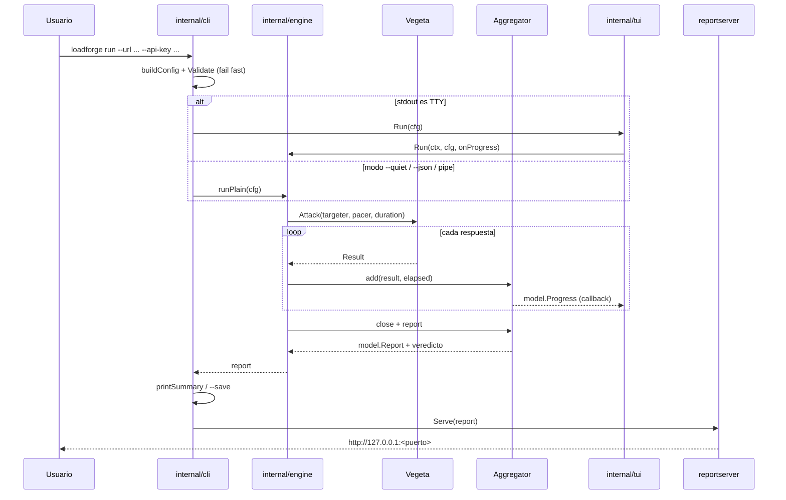

# Arquitectura de LoadForge

Este documento describe el estilo arquitectónico, las dependencias entre
paquetes, los patrones usados y los compromisos conscientes del proyecto.

## 1. Resumen ejecutivo

LoadForge es un **monolito modular en capas** con influencias de
**arquitectura de puertos y adaptadores (hexagonal)**. No es un Clean
Architecture “de libro”, pero sí respeta las ideas centrales:

- Un **modelo de datos independiente** (`internal/model`) que solo depende de
  la librería estándar.
- Un **núcleo de aplicación** (`internal/engine`) que ejecuta la prueba y
  produce un reporte.
- **Adaptadores de entrada/salida** separados: TUI (`internal/tui`) y servidor
  web (`internal/reportserver`).
- Un **composition root** en `internal/cli` que conoce todas las piezas y las
  conecta.
- Una **dirección de dependencias hacia el interior**: los adaptadores conocen
  al modelo y al motor; el modelo no conoce a nadie.

```
cmd/loadforge
     │
     ▼
internal/cli ───────────────┐
     │                      │
     ├──▶ internal/engine ──┼──▶ internal/model
     ├──▶ internal/tui ─────┤
     └──▶ internal/reportserver ─┘
```

## 2. Contexto y restricciones

| Restricción | Decisión |
|---|---|
| Debe correr en Termux, Linux y Windows | Go con `CGO_ENABLED=0` y binario único |
| No debe depender de internet para ver el reporte | SPA, CSS y uPlot embebidos con `go:embed` |
| Debe medir carga HTTP real | Vegeta como motor, `net/http` para el cliente |
| Debe funcionar en terminales modestas | TUI ligera con Bubble Tea y Lip Gloss |
| La API key no debe filtrarse | Nunca se serializa; solo se registran nombres de headers |
| El reporte debe abrirse fácilmente | Servidor local en `127.0.0.1`, puerto aleatorio por defecto |

El proyecto prioriza **utilidad y portabilidad** sobre pureza arquitectónica.
Para 2.300 líneas de producción, introducir capas ceremoniales adicionales
sería más costoso que beneficioso.

## 3. Paquetes y responsabilidades

| Paquete | Responsabilidad | Depende de |
|---|---|---|
| `cmd/loadforge` | Punto de entrada; delega en el CLI | `internal/cli` |
| `internal/cli` | Flags, validación de entrada, composición, resumen final, guardado y ciclo de vida del servidor | `engine`, `model`, `tui`, `reportserver`, `version` |
| `internal/engine` | Generación de carga, pacing, cliente HTTP, agregación, auto-stop y veredicto | `model`, Vegeta, HdrHistogram |
| `internal/model` | Contrato serializable del reporte y snapshot de progreso | Solo `time` |
| `internal/tui` | Adaptador de presentación en terminal | `engine`, `model`, Bubble Tea, Lip Gloss |
| `internal/reportserver` | Adaptador HTTP: sirve la SPA, JSON y CSV | `model`, assets embebidos |
| `internal/version` | Versión inyectada en build y User-Agent | Nada |

No existen dependencias circulares. `internal/model` es la hoja del grafo y
`internal/cli` es el único paquete que conoce todos los demás.

## 4. Flujo de una ejecución



## 5. Patrones y principios aplicados

### Capas y modularidad

- **Package by feature**: cada paquete agrupa una responsabilidad completa, no
  una capa técnica artificial.
- **Dirección de dependencias**: `model` ← `engine` ← `cli`; `tui` y
  `reportserver` son adaptadores que dependen del núcleo.
- **Ocultamiento de implementación**: todo vive bajo `internal/`, así que
  ningún consumidor externo puede acoplarse a los detalles.

### Composition root

`internal/cli` construye el `engine.Config`, elige TUI o modo plano, guarda el
reporte y arranca el servidor. Es el único lugar donde se ensambla la
aplicación; el resto de paquetes no sabe cómo se ejecuta el conjunto.

### Strategy

`linearPacer` implementa la interfaz `vegeta.Pacer`. El mismo motor sirve para
rampa y carga constante cambiando la estrategia de pacing, sin `if` dispersos
en el ataque.

### Observer / callback

`engine.Run` recibe `onProgress func(model.Progress)`. El motor no conoce
Bubble Tea ni la terminal: solo emite snapshots. Esto permite:

- TUI en vivo.
- Progreso simple en stderr.
- Pruebas sin interfaz.
- Futuras salidas (métricas Prometheus, WebSocket, etc.).

### Adapter

- `internal/tui` adapta el progreso a una interfaz Bubble Tea.
- `internal/reportserver` adapta el reporte a HTTP + SPA.
- `internal/cli` adapta flags de Cobra a `engine.Config`.

### DTO y contrato único

`model.Report` es el contrato compartido entre motor, TUI, servidor y archivo
JSON. Tiene `schema_version` para evolucionar sin romper consumidores.

### Fail fast

`Config.Validate` comprueba URL, modo, rates, workers, timeout y umbrales
**antes** de abrir conexiones. Los errores de configuración no generan carga
accidental.

### Seguridad por diseño

- La API key solo vive en memoria y en los headers de la petición.
- `sanitizeURL` redacta credenciales y parámetros sensibles.
- El servidor escucha en loopback por defecto.
- El reporte no incluye valores de headers, solo sus nombres.

## 6. Atributos de calidad

| Atributo | Cómo se aborda |
|---|---|
| **Portabilidad** | Go estático, sin CGO, binarios por plataforma y apertura de navegador específica por SO |
| **Rendimiento** | Workers configurables, keep-alive, HTTP/2 cuando aplica, HDR Histogram y lectura acotada del body |
| **Testabilidad** | `httptest` para integración, lógica de veredicto pura, pacer determinista y tests del servidor |
| **Mantenibilidad** | Paquetes pequeños, nombres explícitos, sin dependencias circulares, `gofmt` + `go vet` |
| **Seguridad** | Redacción de secretos, loopback por defecto, advertencia al exponer el reporte |
| **Experiencia de uso** | TUI en vivo, resumen con color, reporte offline, exportación JSON/CSV/PDF |
| **Operabilidad** | `--json`, `--quiet`, `--save`, `--no-serve`, códigos de salida y Ctrl+C con reporte parcial |

## 7. Compromisos y deuda técnica

Estos puntos son deliberados o candidatos a mejora:

1. **El motor mezcla aplicación e infraestructura.** `internal/engine` contiene
   la lógica de capacidad y también crea el cliente HTTP y usa Vegeta. En una
   arquitectura hexagonal estricta, Vegeta estaría detrás de un puerto
   `LoadGenerator`.
2. **No hay puertos formales para todas las salidas.** `onProgress` es un
   puerto ligero, pero no existen interfaces `ReportStore`, `ReportPresenter`
   o `Runner`. Las funciones concretas son suficientes para el tamaño actual.
3. **`model.Report` cumple dos roles.** Es a la vez modelo de lectura y esquema
   de transporte. Si el producto crece, conviene separar dominio de DTO.
4. **`internal/cli` tiene varias responsabilidades.** Flags, orquestación,
   presentación del resumen y ciclo de vida del servidor. Podría dividirse en
   `runner`, `presenter` y `serve` si aumenta la complejidad.
5. **Sin persistencia ni historial.** No hay repositorio de corridas ni
   comparación entre resultados; el JSON es la única persistencia.
6. **Sin pruebas de arquitectura.** No hay una regla automatizada que impida,
   por ejemplo, que `model` importe `reportserver`.
7. **Un solo endpoint por corrida.** No hay escenarios multi-endpoint,
   dependencias entre pasos ni cargas ponderadas.
8. **El servidor de reporte no tiene autenticación.** Es una decisión
   consciente para un servidor local; se advierte al usar `--host 0.0.0.0`.

## 8. Si se requiere una arquitectura formal “a profundidad”

Para un trabajo académico, auditoría o portafolio que exija Clean/Hexagonal
estricta, la evolución recomendada sería:

```
internal/
  domain/          # Capacity, Threshold, Verdict, Value Objects (sin I/O)
  application/     # RunTest use case + ports
  ports/           # LoadGenerator, ProgressSink, ReportStore, ReportPresenter
  adapters/
    vegeta/        # implementa LoadGenerator
    bubbletea/     # implementa ProgressSink
    httpserver/    # implementa ReportPresenter
    filesystem/    # implementa ReportStore
  model/           # DTO/schema, separado del dominio
cmd/loadforge/     # composition root
```

Con contratos explícitos:

```go
type LoadGenerator interface {
    Run(ctx context.Context, cfg Config, sink ProgressSink) (*model.Report, error)
}

type ReportPresenter interface {
    Present(ctx context.Context, report *model.Report) error
}
```

Y verificación automatizada:

- `go-arch-lint` o un test que inspeccione imports permitidos.
- ADRs en `docs/adr/`.
- Diagramas C4 en `docs/`.
- Pruebas de contrato para cada adaptador.

Eso daría una arquitectura formal, pero añadiría interfaces y capas que hoy no
pagan su coste. La arquitectura actual es la adecuada para una herramienta de
una sola responsabilidad, con un núcleo testeable y adaptadores reemplazables.

## 9. Decisiones de arquitectura (ADR resumidas)

| ID | Decisión | Motivo | Consecuencia |
|---|---|---|---|
| ADR-001 | Go y binario único | Portabilidad Termux/Linux/Windows | Sin runtime externo; builds con `CGO_ENABLED=0` |
| ADR-002 | Vegeta como motor | No reinventar generación de carga | Dependencia externa madura; acoplamiento controlado en `engine` |
| ADR-003 | HdrHistogram para percentiles | Precisión en colas P99/P99.9 | Dependencia adicional; memoria acotada |
| ADR-004 | SPA embebida con uPlot | Reporte offline y portable | Assets dentro del binario; sin CDN |
| ADR-005 | Servidor local con puerto 0 | Evitar colisiones y exponer solo en loopback | URL aleatoria; el usuario puede fijar `--port` |
| ADR-006 | Callback de progreso | Desacoplar motor y UI | No hay bus de eventos; suficiente para una salida |
| ADR-007 | Modelo JSON versionado | Compatibilidad hacia adelante | `schema_version` debe incrementarse en cambios incompatibles |

## 10. Cómo verificar la arquitectura

```bash
# Grafo de dependencias
go list -f '{{.ImportPath}} -> {{join .Imports " "}}' ./internal/... ./cmd/...

# El modelo no debe importar paquetes del proyecto
go list -f '{{join .Imports " "}}' ./internal/model | tr ' ' '\n' | grep '^loadforge/' || echo "modelo independiente"

# Calidad
go test ./...
go vet ./...
```

## 11. Conclusión

LoadForge **sí tiene una arquitectura de software identificable y coherente**:
monolito modular, capas con dependencias unidireccionales, composition root,
estrategias, callbacks y adaptadores. Cumple los principios de separación de
responsabilidades, bajo acoplamiento y alta cohesión.

Lo que no es: una implementación estricta de Clean Architecture o Hexagonal,
porque el núcleo aún conoce Vegeta y `net/http`, y no todos los límites están
expresados como interfaces. Es una arquitectura **adecuada al problema y al
tamaño del proyecto**, con una ruta clara para formalizarse si el producto o
la evaluación lo exigen.
